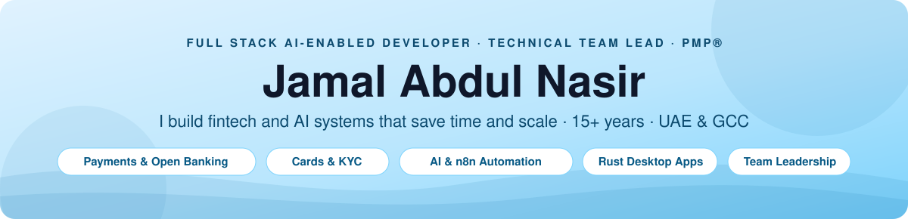

<!-- HEADER: switches with GitHub light / dark theme. Click opens website. -->
<a href="https://jamalabdulnasir.tech">
  <picture>
    <source media="(prefers-color-scheme: dark)" srcset="./assets/header-dark.svg">
    <source media="(prefers-color-scheme: light)" srcset="./assets/header-light.svg">
    
  </picture>
</a>

  

<table>
  <tr>
    <td align="center" width="180"><h2>15+</h2>years in delivery</td>
    <td align="center" width="180"><h2>150M</h2>monthly visitors reached</td>
    <td align="center" width="180"><h2>2.5M+</h2>app downloads</td>
    <td align="center" width="180"><h2>15+</h2>fintech & ERP integrations</td>
  </tr>
</table>

## 🔭 Right Now

- 🏦 **Technical Team Lead** at **Tmam Payment Services Provider**: cards, open banking, KYC and payroll (WPS)
- 👥 Building **[iHRMS.io](https://ihrms.io)**: multi-tenant HR software for UAE and GCC companies
- 🤖 Designing **AI and n8n workflows** that remove manual work from finance, HR and support teams
- 🦀 Building **local-first desktop apps in Rust + Tauri** (see *In the Lab* below)
- 🧭 Leading teams with **PMP®** planning and AI-assisted delivery

## 🎯 What I Do For You

<table>
  <tr>
    <td width="50%" valign="top">
      <h4>💳 Fintech & Payments</h4>
      Card issuance, open banking and payment gateways that work in production.
    </td>
    <td width="50%" valign="top">
      <h4>⚡ Less Manual Work</h4>
      AI and n8n automations for email, documents, CRM, reporting and support.
    </td>
  </tr>
  <tr>
    <td valign="top">
      <h4>🧱 End-to-End Products</h4>
      Idea, architecture, code, testing, deployment and support from one owner.
    </td>
    <td valign="top">
      <h4>🚀 Faster Delivery</h4>
      AI-assisted development with strict code review, so speed does not cost quality.
    </td>
  </tr>
  <tr>
    <td colspan="2" valign="top" align="center">
      <h4>🧑‍✈️ Technical Leadership</h4>
      A hands-on, PMP-certified lead who plans delivery, mentors engineers and removes blockers.
    </td>
  </tr>
</table>

## 📈 Proof

| | Area | Result |
|:---:|---|---|
| 🛍️ | **Scale** | Grew **Emaar Malls** division websites from **10K to 150M** monthly visitors |
| 📱 | **Mobile** | Contributed to **The Dubai Mall** iOS and Android apps (**2.5M+** downloads) |
| 💳 | **Cards & KYC** | Integrated Infinios, i2c, Stripe Card Issuance, JUMIO, Sijilat, LMRA and WPS at **Tmam** |
| 🧾 | **Finance automation** | Connected Zoho, QuickBooks, Xero, Tally, Odoo, Railz and Monite to cut manual finance work |
| 📊 | **Trading** | Connected MT4, MT5 and cTrader at **Multibank** |
| 🧠 | **GenAI** | Pipelines that turn CVs into structured JSON and classify invoices automatically |

**Trusted by** 

## 🏗️ Products I've Built

| Product | What it is | Stack |
|---|---|---|
| 💳 [**Tmam.io**](https://tmam.io) | Fintech and payment platform | `PHP` `Laravel` `React` `MySQL` |
| 👥 [**iHRMS.io**](https://ihrms.io) | HR management SaaS for the GCC | `PHP` `Laravel` `MySQL` |
| 📊 **The Dubai Mall Statistics Dashboard** | Management reporting | `PHP` `Laravel` `React` `MongoDB` |
| 🧩 **NexsysOne Vendor Management** | SaaS ERP module with rule-based onboarding | `SaaS` `ERP` |
| 📈 **Multibank Back Office** | Trading and operations apps | `PHP` `Symfony` `MySQL` |

## 🦀 In the Lab: Rust Desktop Apps

Native, lightweight and private. Built with <b>Rust + Tauri</b>, local-first, with no server in the loop. You can use your own AI key (OpenAI, Claude, Gemini) or run local models.

<table>
  <tr>
    <td width="50%" valign="top">
      <h4>🎬 ScriptLoom</h4>
      Turns a script, your clips, or both into finished videos for YouTube, TikTok, LinkedIn, Facebook and Instagram. Choose a style: cinematic, corporate, cartoon and more.  
      <code>Rust</code> <code>Tauri</code> <code>FFmpeg</code> <code>SQLite</code> <code>whisper-rs</code> <code>Piper TTS</code> 
      
    </td>
    <td width="50%" valign="top">
      <h4>🛡️ ShadowTrace (working name)</h4>
      A security tool that watches any software from the outside: file, database and network activity, a dependency map, and plain-English AI explanations. It never modifies the app it watches.  
      <code>Rust</code> <code>Windows-first</code> <code>Local + Cloud AI</code> 
      
    </td>
  </tr>
  <tr>
    <td valign="top">
      <h4>💓 PulseLens</h4>
      Reads heart and breathing rate from a normal webcam, with the user's consent. Everything runs on the device, and the data never leaves it.  
      <code>Rust</code> <code>Tauri</code> <code>ONNX Runtime</code> <code>Python research</code> 
      
    </td>
    <td valign="top">
      <h4>🧠 Local AI Agent Builder</h4>
      Create agents that run system tasks on schedules, file changes or hotkeys. Tasks are defined in simple YAML and run with an optional AI planner.  
      <code>Rust</code> <code>Tauri</code> <code>SQLite</code> <code>Ollama</code> 
      
    </td>
  </tr>
  <tr>
    <td valign="top">
      <h4>📚 Papyr</h4>
      An offline research workspace for PhD students. It joins reference management and linked notes: PDF highlights become notes, citations are typed inline, and every paper shows the notes that mention it.  
      <code>Rust</code> <code>Tauri</code> <code>SQLite</code> <code>Local AI</code> <code>OpenAlex</code> <code>Unpaywall</code> 
      
    </td>
    <td valign="top">
      <h4>🪙 Solana Desktop Suite (working name)</h4>
      One app for Solana users, traders and developers: a transaction firewall, an MEV auditor, a program upgrade watchdog, a time-machine debugger, and a portfolio and tax tracker.  
      <code>Rust</code> <code>Tauri</code> <code>Solana</code> <code>SQLite</code> 
      
    </td>
  </tr>
</table>

## 🤖 AI Automation I Can Build

<b>See 7 ready-to-build solutions ▾</b>

 

| Solution | Result for your business |
|---|---|
| 📧 **Email processing** | Attachments are read, sorted and sent to your CRM and dashboards |
| 💬 **AI chatbots** | Customer questions answered through OpenAI and your support tools |
| 📞 **AI voice agents** | Calls handled with Vapi or Retell AI, with CRM updates and summaries |
| 📚 **RAG knowledge search** | Staff and customers get answers from your own PDFs and documents |
| 📰 **Research and news digests** | Daily briefs with sources, summaries and key points |
| 📣 **Social media automation** | Scheduled posts, AI captions and analytics logging |
| 📅 **Meeting scheduling** | Bookings made automatically with Google Calendar |

## ⚙️ How I Work

`🔍 Understand` ➜ `🗺️ Plan` ➜ `🛠️ Build` ➜ `✅ Review` ➜ `🚀 Launch & Support`

1. **Understand:** clear requirements, scope and success measures
2. **Plan:** architecture, data models and API contracts before coding
3. **Build:** fast delivery with Cursor, Claude and AI coding agents
4. **Review:** every AI-generated change is checked for security, speed and maintainability
5. **Launch and support:** deployment, monitoring and continuous improvement

## 🛠️ Tech I Use

<table>
  <tr>
    <td width="190"><b>💻 Languages & Frameworks</b></td>
    <td><picture><source media="(prefers-color-scheme: dark)" srcset="https://skillicons.dev/icons?i=php,laravel,symfony,rails,py,nodejs,js,jquery,react,html,css,rust,tauri&theme=dark"></picture> </td>
  </tr>
  <tr>
    <td width="190"><b>🗄️ Data & Messaging</b></td>
    <td><picture><source media="(prefers-color-scheme: dark)" srcset="https://skillicons.dev/icons?i=mysql,postgres,mongodb,redis,sqlite,kafka,supabase,firebase&theme=dark"></picture></td>
  </tr>
  <tr>
    <td width="190"><b>☁️ Cloud & DevOps</b></td>
    <td><picture><source media="(prefers-color-scheme: dark)" srcset="https://skillicons.dev/icons?i=aws,docker,githubactions,github,linux,ubuntu,nginx&theme=dark"></picture>        </td>
  </tr>
  <tr>
    <td width="190"><b>🤖 AI & Automation</b></td>
    <td>                  </td>
  </tr>
  <tr>
    <td width="190"><b>💳 Payments & Cards</b></td>
    <td>           </td>
  </tr>
  <tr>
    <td width="190"><b>🧾 Accounting & ERP</b></td>
    <td>       </td>
  </tr>
  <tr>
    <td width="190"><b>🤝 CRM & Support</b></td>
    <td>       </td>
  </tr>
  <tr>
    <td width="190"><b>📈 Trading</b></td>
    <td>  </td>
  </tr>
  <tr>
    <td width="190"><b>🗂️ Delivery & PM</b></td>
    <td>      </td>
  </tr>
</table>

<b>More automation tools I work with ▾</b>

 

                  

## 📊 GitHub Activity

  <picture>
    <source media="(prefers-color-scheme: dark)" srcset="https://github-readme-stats.vercel.app/api?username=jamalnasir&show_icons=true&hide_border=true&bg_color=0D1117&title_color=38BDF8&icon_color=38BDF8&text_color=C9D1D9">
    
  </picture>
  <picture>
    <source media="(prefers-color-scheme: dark)" srcset="https://github-readme-stats.vercel.app/api/top-langs/?username=jamalnasir&layout=compact&hide_border=true&bg_color=0D1117&title_color=38BDF8&text_color=C9D1D9">
    
  </picture>

 

<!-- FOOTER: switches with GitHub light / dark theme. Click opens LinkedIn. -->
<a href="https://www.linkedin.com/in/jamal-a-nasir">
  <picture>
    <source media="(prefers-color-scheme: dark)" srcset="./assets/footer-dark.svg">
    <source media="(prefers-color-scheme: light)" srcset="./assets/footer-light.svg">
    
  </picture>
</a>

